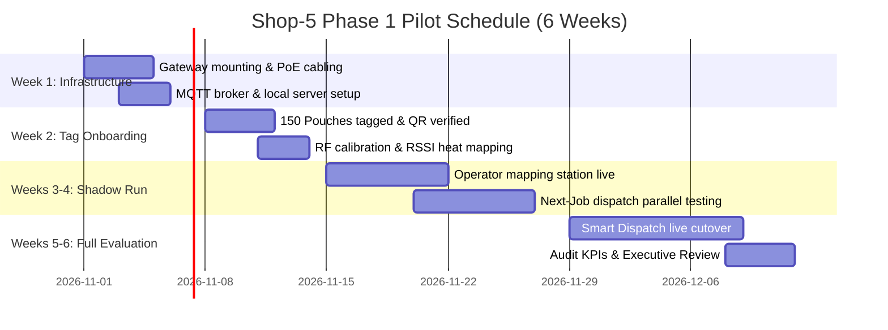

# Phase 1 Pilot Implementation Plan: INDO-MIM Shop-5
## Focused Pilot: VMC Bay 1 + Central Rack Storage + Metrology Room

---

## 1. Pilot Scope & Work Center Selection

To de-risk deployment before floor-wide rollout across all 111 machines:
- **Pilot Area**: VMC Zone A, Bay 1 (Machines **VMC-01 through VMC-10**).
- **Storage Sub-Area**: Central WIP Racks **C-1, C-2, and C-3** (36 active shelf slots).
- **Inspection Station**: Metrology Lab (Standard Room / Zeiss CMM-01).
- **Tracked Pouches**: **150 Active Pouches** equipped with BLE 5.0 tags and QR barcodes.
- **Hardware Installed**: 2x PoE BLE Gateways (RX-05, RX-07) + 1x Tablet Handheld Scanner.

---

## 2. 6-Week Rollout Timeline

---

## 3. Success Metrics & Validation Gate

| KPI Metric | Baseline (Pre-Pilot) | Pilot Target | Stretch Target |
| :--- | :---: | :---: | :---: |
| **Pouch Physical Search Time** | 18.2 minutes | **< 45 seconds** | < 20 seconds |
| **Lost Job Incidents** | 3.5 / month | **0 incidents** | 0 incidents |
| **RF Read Reliability** | N/A | **> 98.5%** | > 99.5% |
| **Machine Waiting-for-WIP Idle** | 14.8% of shift | **< 6.0%** | < 3.5% |
| **Operator Adoption Rate** | 0% | **> 90%** | 100% |
| **On-Time Operation Completion** | 89.2% | **> 96.0%** | > 98.5% |

---

## 4. Go / No-Go Decision Gate for Plant-Wide Rollout

Upon successful conclusion of Week 6, if search time is under 45 seconds and zero lost-job incidents are recorded, the steering committee will authorize immediate Phase 2 rollout across remaining VMC Zones B/C (80 machines) and WEDM (21 machines).
